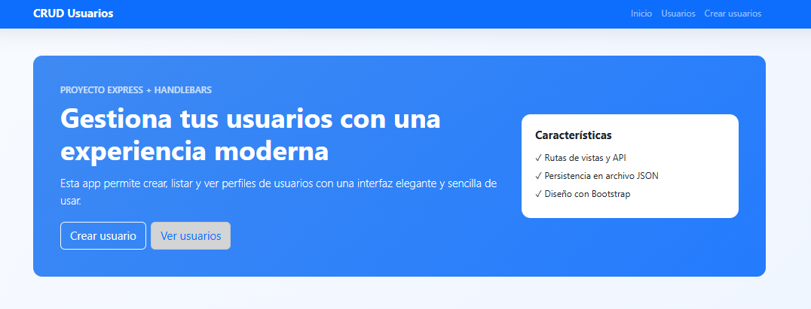
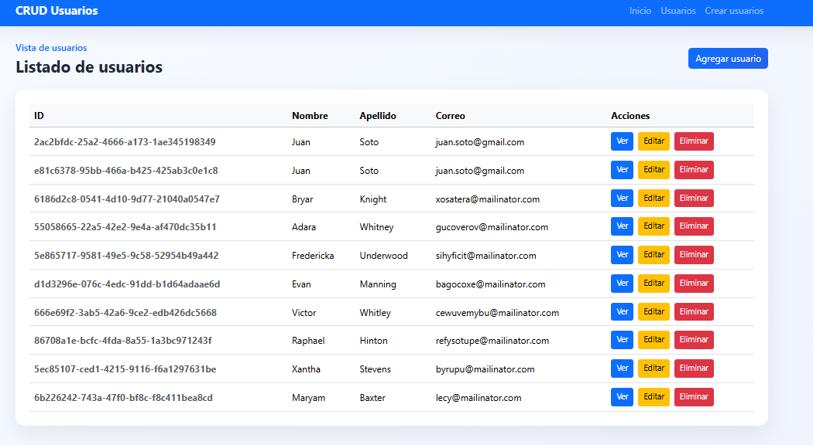
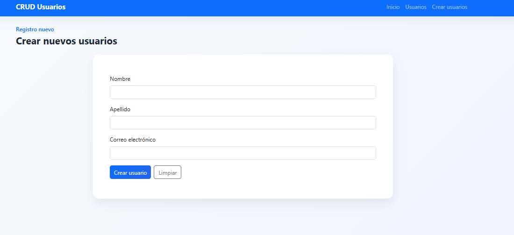

# App Consola - CRUD de usuarios

Aplicación web simple con Express y Handlebars para gestionar usuarios mediante una interfaz estilo Bootstrap.

## Requisitos

- Node.js 18 o superior
- npm

## Instalación

```bash
npm install
```

## Ejecución

```bash
npm start
```

La app queda disponible en:

- http://localhost:3000

También puedes correrla con un puerto personalizado:

```bash
node server.js --puerto 3001
```

## Estructura principal

- `src/app.js`: configuración de Express y Handlebars
- `src/routes/`: rutas de vistas y API
- `src/controllers/`: lógica de controladores
- `src/models/`: modelo de usuario
- `src/views/`: plantillas de Handlebars
- `src/data/usuarios.json`: archivo de persistencia de usuarios

## Evidencias de uso

<p>1.- Pagina principal<p>


<hr>

<p>2.- Listado de usuarios<p>


<hr>

<p>3.- Crear nuevo usuario<p>
